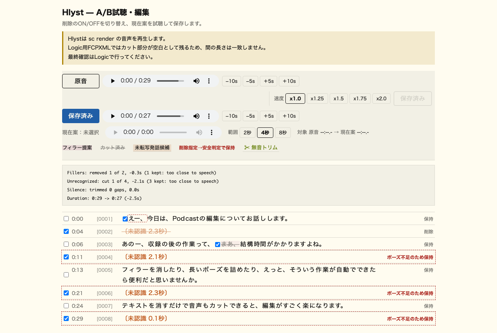

<p align="center">
  
  
</p>

<h1 align="center">Stefnceorf</h1>

<p align="center">
  <strong>ワンコマンドでポッドキャスト下処理 — ローカル・無料・AIエージェントで拡張可能</strong>
</p>

<p align="center">
  <a href="LICENSE"></a>
  
  
  <a href="README.md">English</a>
</p>

---

Stefnceorf は、**ワンコマンドでポッドキャスト音声の下処理をする**無料のCLIツールです。`sc episode.wav` を実行するだけで、文字起こし・フィラー除去・長い無音の切り詰め・Logic Pro 用 FCPXML 出力までが一括で完了します。全処理ローカル完結・クラウド不使用。[Descript](https://www.descript.com/) のローカル・無料・日本語ネイティブ対応版です。

さらに細かく編集したい場合は、生成されたトランスクリプトをテキストエディタで編集して、追加のカットや並べ替えを行うこともできます。

正式コマンドは `stefnceorf`（古英語 *stefn*「声」+ *ceorfan*「切る」）、短縮形 `sc`（同一動作）です。

<p align="center">
  
</p>
<p align="center"><em>Hlyst（<code>sc review --serve</code>）— チェックボックスで削除を切り替え、実レンダー音を即 A/B 試聴して、トランスクリプトへ保存できます。</em></p>

## クイックスタート

```sh
# 典型的なポッドキャスト制作フロー:
# 1. 音声を収録
# 2. Audacity 等でノイズ除去
# 3. ワンコマンドで下処理:
sc episode.wav                   # → episode.logic.fcpxml (+ .sc.txt / .sc.json)
# 4. Logic Pro に FCPXML をインポート (File > Import > Final Cut Pro XML)
```

`sc episode.wav` で文字起こし・フィラー除去・長い無音の切り詰め・FCPXML出力が一括実行されます。

さらに細かく編集したい場合はステップ実行をお使いください:

```sh
sc transcribe episode.wav       # episode.sc.txt / episode.sc.json を生成
$EDITOR episode.sc.txt          # テキストを編集（削除・並べ替え）
sc review episode.sc.txt --serve  # ブラウザで A/B 試聴し、削除の ON/OFF を編集（Hlyst）
sc render episode.sc.txt        # episode.edited.wav を生成
sc logic episode.sc.txt         # Logic Pro 用 episode.logic.fcpxml を生成
```

## ポッドキャスト音声編集の機能

- **ワンコマンド実行** — `sc episode.wav` で文字起こし → フィラー検出 → 無音切り詰め → FCPXML出力を一括実行します。収録 → ノイズ除去（Audacity）→ `sc` → Logic Pro のワークフローに最適です
- **全処理ローカル完結・無料** — mlx-whisper による Apple Silicon GPU 文字起こし。クラウド不使用・APIキー不要
- **Logic Pro 連携** — FCPXML を出力し、Logic Pro の File > Import > Final Cut Pro XML で直接読み込めます。フェードを持たない仕様の補完として、各リージョン端を最大5ms内側の静音点（−50dBFS以下）へ自動補正し、クリックノイズを防ぎます
- **フィラー語の自動検出・除去** — 辞書ベースで「えー」「まあ」等を検出します。auto ワークフローでは自動除去、ステップ実行では `〔〕` で提案して確認を求めます
- **長い無音の自動切り詰め** — 1.2秒を超える無音を自動短縮します。セグメント内のギャップも閾値を超えると分割・切り詰めされます
- **verbatim モード** — Whisper が通常吸収するフィラーも転写します。正確なフィラー検出のため既定で有効です。v0.3.0 から高速な turbo モデル＋チャンク毎プロンプト方式になり、3エピソードの A/B テストで従来の large-v3 方式よりフィラー捕捉数が増え、速度は2倍になりました
- **幻覚検出＋レスキュー** — 繰り返し幻覚を自動検出し、安全設定で再認識して復旧します
- **未転写発話の検出とガード付きカット** — Whisper が転写しない短い発声（100〜150ms の「え」「ん」、息、相槌など）を検出し、`〔未認識 N.N秒〕` 行として既定で削除指定します。実際にカットされるのは、前後の検出済み無音から合計0.25秒の間を残せる安全な場合だけで、足りなければ音声を保持します。`〔〕` を外せば保持、`--no-auto-uts` で検出のみ（常に音声保持）に戻せます
- **Hlyst — ブラウザ A/B 試聴・編集** — `sc review episode.sc.txt` で編集後音声を実レンダーし、原音と聴き比べられるブラウザページ（Hlyst、古英語で「聴くこと」）を生成します。`--serve` を付けると対話モードになり、チェックボックスで削除を ON/OFF → 即試聴 → `.sc.txt` へ保存できます。`--no-open` で自動オープンを抑止できます
- **音質保持** — WAV render出力は元 wav と同一のサンプルレート・ビット深度。カット境界は等パワークロスフェード
- **日本語・英語対応** — 言語別フィラー辞書付き
- **テキスト編集も可能** — auto ワークフローの後にさらに細かい編集をしたい場合、生成されたトランスクリプトをテキストエディタで編集できます。カット点はポーズ境界と無音の谷にスナップしクロスフェードされるため、**テキストを消すだけでわりと自然に聞こえる編集結果が得られます**。v0.3.0 からはトランスクリプト自体も turbo モデルの自然な表記で読みやすくなりました。[テキスト編集（任意）](#テキスト編集任意)を参照してください

## ポッドキャスト音声編集ツール比較

| | Stefnceorf | Descript | Hindenburg | Audacity |
|---|---|---|---|---|
| **価格** | 無料（MIT License） | $24+/月 | $15+/月 | 無料（OSS） |
| **主な操作** | ワンコマンドCLIパイプライン | GUIテキスト編集 | GUI波形＋テキスト | GUI波形編集 |
| **音声処理** | ローカル（Apple Silicon GPU） | クラウド | ローカル | ローカル |
| **プライバシー** | 音声がマシン外に出ない | 音声をサーバーにアップロード | ローカル処理 | ローカル処理 |
| **日本語対応** | ネイティブ（文字起こし＋フィラー検出） | 限定的 | なし | なし |
| **フィラー除去** | 自動（auto）/ 半自動（ステップ実行） | 自動 | 手動 | 手動 |
| **編集プレビュー** | ブラウザ A/B 試聴＋対話編集（`sc review --serve`） | アプリ内再生 | アプリ内再生 | アプリ内再生 |
| **Logic Pro 連携** | FCPXML出力（クリック防止エッジ補正付き） | なし | なし | なし |
| **AIエージェント拡張** | 対応（CLAUDE.md、テストスイート完備） | なし | なし | なし |
| **インターフェース** | CLI | GUIアプリ | GUIアプリ | GUIアプリ |
| **プラットフォーム** | macOS（Apple Silicon） | macOS, Windows, Web | macOS, Windows | macOS, Windows, Linux |
| **動画編集** | 音声のみ | 音声＋動画 | 音声のみ | 音声のみ |

**Stefnceorf が向いている場合:** Apple Silicon で無料・ローカルのワンコマンドポッドキャスト下処理パイプラインが必要な方。特に日本語コンテンツに最適です。
**Descript が向いている場合:** GUI、動画編集、クロスプラットフォーム対応が必要な場合。
**Hindenburg が向いている場合:** 波形とテキストの両方のビューを備えた専用ポッドキャスト GUI エディタが必要な場合。
**Audacity が向いている場合:** クロスプラットフォーム対応の無料 GUI 波形エディタが必要な場合。

## 前提

- Apple Silicon Mac（M1 / M2 / M3 / M4）
- Python 3.11+
- ffmpeg インストール済み（`brew install ffmpeg`）
- 入力はノイズ除去済みの wav（無音の切り詰めは stefnceorf が行います）

## インストール

```sh
# uv を使う場合（推奨）
uv venv
uv pip install -e .

# pip を使う場合
python -m venv .venv
.venv/bin/pip install -e .
```

`stefnceorf` と `sc` の2コマンドが登録されます。`sc trans` は `sc transcribe` の短縮エイリアスです。

最初の引数が `.wav` ファイルの場合、`auto` サブコマンドが自動で実行されます：`sc episode.wav` = `sc auto episode.wav`。

依存: [mlx-whisper](https://github.com/ml-explore/mlx-examples/tree/main/whisper), numpy, soundfile

### どこからでも使えるようにする（任意）

editable インストール後、`.venv/bin/` にある実行ファイルへシンボリックリンクを張ると、どのディレクトリからでも実行できます。

```sh
ln -s "$(pwd)/.venv/bin/stefnceorf" /opt/homebrew/bin/stefnceorf
ln -s "$(pwd)/.venv/bin/sc" /opt/homebrew/bin/sc
```

## コマンド一覧

| コマンド | 用途 | 例 |
|---|---|---|
| `sc auto` | 文字起こし → フィラー除去 → 無音切り詰め → FCPXML を一括実行（`.wav` 入力時の既定） | `sc episode.wav` |
| `sc transcribe` | 編集用 `.sc.txt` + `.sc.json` を生成（短縮形 `trans`） | `sc transcribe episode.wav` |
| `sc review` | 実レンダーからブラウザ A/B 試聴ページを生成。`--serve` で対話編集（Hlyst） | `sc review episode.sc.txt --serve` |
| `sc render` | 編集結果を元音源から WAV に書き出し | `sc render episode.sc.txt -o out.wav` |
| `sc logic` | 編集後 `.sc.txt` から Logic Pro 用 FCPXML を出力 | `sc logic episode.sc.txt` |

各編集コマンドは終了時に編集サマリを表示します：行の残数／削除数（削除秒数付き）、フィラー除去数（削除秒数付き）、切り詰めた無音の箇所数、全体の尺の変化です。

## 使い方

### auto（既定のワークフロー）

```sh
sc auto input.wav [--lang ja|en] [--verbatim] [--no-filler-suggest] [--model MODEL] [-o output.fcpxml]
```

文字起こしからフィラー除去・無音切り詰め・FCPXML出力までをワンコマンドで実行します。出力されたFCPXMLは Logic Pro の **File > Import > Final Cut Pro XML** で読み込めます。

- `.wav` ファイルを直接渡すと auto が自動実行されます：`sc input.wav` = `sc auto input.wav`
- `input.sc.txt` と `input.sc.json` もあわせて生成されます
- すべての文字起こしオプション（`--lang`、`--verbatim`、`--model` 等）に対応しています
- トランスクリプトを手動編集したい場合は、以下のステップ実行をお使いください

### 文字起こし

```sh
sc transcribe input.wav [--lang ja|en] [--verbatim] [--no-filler-suggest] [--model MODEL] [--pause-threshold 0.15]
```

- `input.sc.txt`（人間が編集するテキスト）と `input.sc.json`（単語→時刻・信頼度の対応表）を生成します。完了時にフィラー候補数と未転写発話候補数を表示します
- `--lang` 既定 `ja`。英語は `--lang en`
- `--model` 既定 `mlx-community/whisper-large-v3-turbo`。幻覚レスキューはこの設定に関わらず `mlx-community/whisper-large-v3-mlx` で再認識します
- `--verbatim`（既定で有効）: フィラーも転写します。`--no-verbatim` で無効化。通常転写と同じ turbo モデルを使い、約30秒の短チャンクに分割して各チャンクへフィラー例文プロンプトを再投入します（`condition_on_previous_text=False`）。速度は非verbatimと同等以上です。チャンク境界でまれに出る定型幻覚は後処理で検出し、その窓を large-v3 モデルで再認識してレスキューします
- `--no-filler-suggest` でフィラー提案を無効化
- `--auto-uts`（既定で有効）: 未転写発話候補・未認識区間を `〔未認識 N.N秒〕` 行として既定で削除指定します。実際のカットは前後の検出済み無音から合計0.25秒の間を残せる場合のみ行われます。`--no-auto-uts` で検出のみ（`⚠ 未認識区間 N.N秒（音声保持）` 表示、常に音声保持）に戻ります
- `--pause-threshold`（既定 0.15秒）: ブロック境界の最小ポーズ長。`0` で単語単位削除（旧挙動）
- 認識用の一時 wav で長い無音（1.2秒以上）を 0.7秒に切り詰め、Whisper の幻覚を抑止します。単語時刻は元音源へ逆写像するため出力に影響はありません

### テキスト編集（任意）

auto ワークフローの結果をさらに細かく調整したい場合に、`input.sc.txt` をテキストエディタで編集します。トランスクリプトは自然な表記（v0.3.0 以降）で読みやすく、カット点はポーズ境界と無音の谷にスナップするため、テキスト編集だけで自然に聞こえる結果が得られます:

```
[0001 0:00] 今日はポッドキャストの／編集についてお話ししたいと思います
[0002 0:07] 〔えー〕やっぱり収録したあとの／編集作業って◆けっこう大変で
[0003 0:18] まあ、テキストを消すだけで／音声もカットできるっていうのは／画期的ですよね〔まあ〕
```

- **行削除** → セグメント全体が音声から消えます
- **行の並べ替え** → その順で音声が再構成されます（行単位のみ。行内の語順入れ替えは非対応）
- **行内の文字削除** → ブロック単位で対応する単語の音声が消えます
- **`〔...〕`（フィラー提案）** → **括弧ごと残す＝削除指定**。音声に残したいフィラーは括弧だけ外します（`〔まあ〕` → `まあ`）
- **`／`（ポーズ区切り）** → 安全なカット点。ブロック内を1文字でも消すとブロック全体が消えます
- **`◆`（低信頼マーカー）** → 聞き直し用の印。render は無視します
- **未転写発話・未認識区間** → `〔未認識 N.N秒〕` 行として既定で削除指定されます。`〔〕` を外せば音声保持です（`--no-auto-uts` 時は保持のみの `⚠` 行になります）
- **追加・書き換えは不可** → 元音声が存在しないため警告のみ（削除のみ有効）
- **ID のない行・不明な ID** → render がエラーで停止します

### A/B 試聴・編集（Hlyst）

```sh
sc review input.sc.txt [--serve] [--port N] [--no-open] [--gap-threshold 1.2] [--gap-max 0.7]
```

- 現在の `.sc.txt` を実レンダーした `input.review.wav` と、試聴ページ `input.review.html`（Hlyst、古英語 *hlyst*「聴くこと」）を生成し、ブラウザで自動的に開きます（`--no-open` で抑止）
- ページにはタイムスタンプ付きトランスクリプトが表示され、削除済み行は取消線、フィラー・未転写発話候補・無音切り詰めはハイライトされます。削除指定したもののポーズ不足で保持された箇所（安全判定による保持）も明示されます
- 行や単語をクリックすると該当位置の前後数秒を再生でき、原音／編集後を再生速度 x1.0〜x2.0 で聴き比べられます
- `--serve` なしでは読み取り専用です。判断を変えるときは `.sc.txt` を編集して `sc review` を再実行してください
- `--serve` を付けるとローカルサーバー（127.0.0.1 のみ。`--port` 既定は空きポート自動選択）による対話モードになります。チェックボックスで削除を ON/OFF → 現在案を前後 ±2/4/8 秒の窓で即試聴 → 保存すると `.sc.txt` の該当行だけがパッチされ（`.bak` を作成）、`review.wav` が再生成されます。Ctrl-C で終了します
- この A/B は `sc render` の結果を正確に反映します。Logic Pro 用 FCPXML は削除をタイムライン上の空白として残すため、Logic 上での再生とは異なります。最終確認は Logic で行ってください

### 音声へ反映

```sh
sc render input.sc.txt [-o output.wav] [--gap-threshold 1.2] [--gap-max 0.7]
```

- 編集後 txt と `input.sc.json` を突き合わせ、**元の input.wav** から切り出して再構成します
- `-o` 省略時の出力は `input.edited.wav`
- `--gap-threshold`（既定 1.2秒）以下のポーズはそのまま、超えるポーズは `--gap-max`（既定 0.7秒）に切り詰めます
- 非破壊。何度でも再実行可能です

### Logic Proへ渡す

```sh
sc logic input.sc.txt [-o output.fcpxml] [--gap-threshold 1.2] [--gap-max 0.7]
```

- `-o` 省略時の出力は `input.logic.fcpxml`
- Logic Proで **File > Import > Final Cut Pro XML** を選び、このファイルを読み込みます
- FCPXMLは元のWAVを直接参照し、テキストの削除・行の並べ替え・フィラー採否・長い無音の扱いを反映します
- 通常の削除は削除尺と同じ空白として残り、並べ替えたリージョンの境界には1秒の空白が入ります。フェード／クロスフェードは含まれないため、必要に応じてLogicで設定してください
- フェードを持たない仕様の補完として、各リージョン端を最大5ms内側の静音点（−50dBFS以下）へ自動補正し、クリックノイズを防ぎます
- 元のWAVを移動すると、Logicで再リンクが必要になる場合があります

## フィラー辞書のカスタマイズ

フィラー候補は辞書との**完全一致**で `〔〕` に包まれます。辞書はパッケージ同梱ファイル（1行1語）で編集できます:

- 日本語: `stefnceorf/fillers_ja.txt`（既定: あのー, そのー, えー, えっと, えと, えーと, えーっと, まあ, まー, うーん）
- 英語: `stefnceorf/fillers_en.txt`（既定: um, uh, uhm, er, ah）

## フォーク＆AIエージェントでカスタマイズ

このリポジトリは、AIコーディングエージェント（[Claude Code](https://docs.anthropic.com/en/docs/claude-code)、Cursor、GitHub Copilot 等）で**フォークして自分用に改造する**前提で設計されています。

同梱されているもの:

- **`CLAUDE.md`** — Claude Code 用のプロジェクトコンテキスト
- **`AGENTS.md`** — AIエージェント用のワークフロー指示
- **網羅的なテストスイート** — ユニットテスト、CLIテスト、受け入れテスト
- **シンプルな Python コードベース** — 7モジュール、約7,000行

AIエージェントへのプロンプト例:

> 「render コマンドに SRT 字幕出力を追加して」

> 「pyannote で話者分離を追加して」

> 「mlx-whisper を faster-whisper に置き換えて Linux で動くようにして」

## 処理時間の目安

25分の WAV ファイル（144 MB）を M4 Pro MacBook Pro（48 GB RAM）で処理した場合、文字起こしからフィラー除去・無音切り詰め・FCPXML出力まで約1.5分で完了します。（v0.3.0 で verbatim 転写を turbo モデルに切り替え、処理時間が半分以下になりました。）処理時間は音声の長さにおおむね比例します。

## 制約と注意

- 日本語の文字起こし精度は 93–95% 程度。固有名詞・専門用語はブレやすいです
- 単語タイムスタンプの誤差は前後 20ms のマージンとクロスフェードで緩和しますが、**最終的に通しで1回聞くことを前提**としてください
- `--verbatim` はチャンク境界でまれに定型幻覚（「ご視聴ありがとうございました」等）を出すことがあります。時間密度チェックで自動検出・レスキューされますが、警告された区間は聞き直してください
- 対象は音声のみ。動画・テロップ出力、ノイズ除去は対象外です

## 開発・テスト

```sh
.venv/bin/python -m pytest -q
```

実モデル（mlx-whisper）や `say` コマンドを使う重いテストは `slow` マーカーが付いており、既定ではスキップされます。`-m slow` で実行できます。

## ロードマップ

- [ ] SRT 字幕出力
- [ ] 固有名詞辞書
- [ ] 話者分離
- [ ] 動画対応

## ライセンス

[MIT License](LICENSE)
